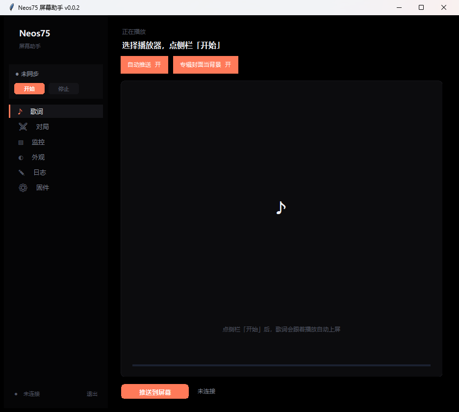
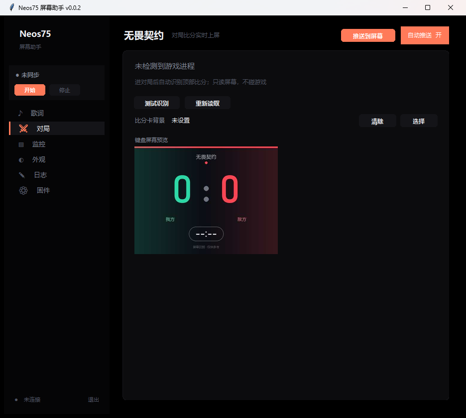
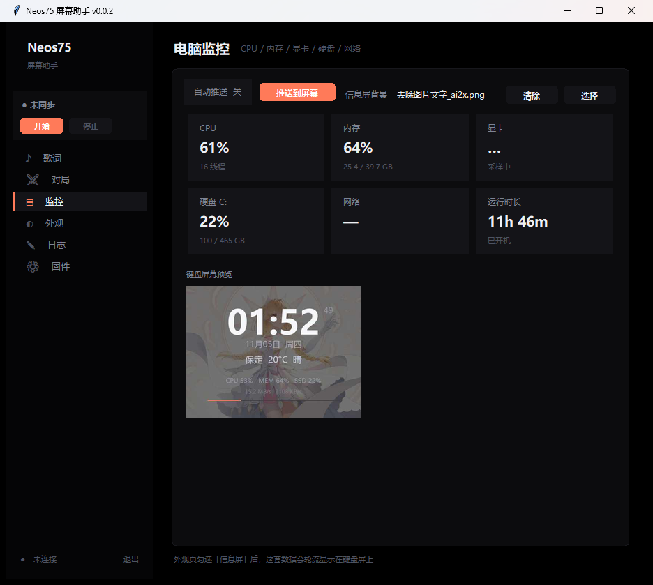
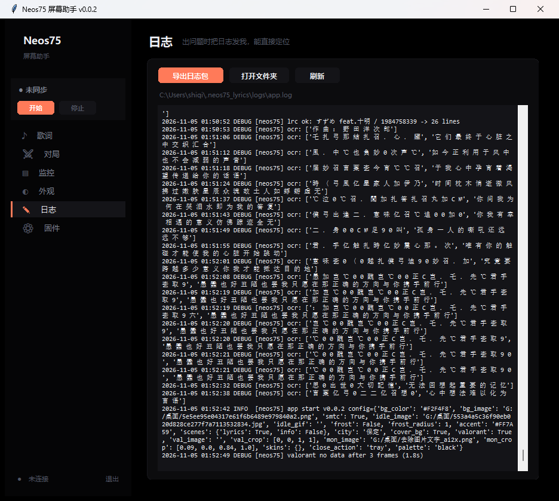

# Neos75 屏幕助手

把 AULA Neos75（三模机械键盘）那块 480×360 的小屏幕变成电脑的「第二块状态屏」：
实时歌词、专辑封面、无畏契约对局比分、CPU/显卡/内存/网络监控，都能推上去。

> 本仓库是 **0.0.3** 的源码。程序为 Windows 桌面应用（Python + tkinter）。
> 只支持 **USB 有线** 连接——2.4G 接收器与蓝牙不转发屏幕数据。



## 功能

| 模块 | 说明 |
| --- | --- |
| 歌词 | 系统媒体会话（SMTC）或网易云桌面歌词 OCR，自动匹配 LRC，可跟专辑封面做背景 |
| 对局 | 无畏契约：读屏幕顶部 HUD 识别比分与回合倒计时，进出对局自动切换 |
| 监控 | CPU / 内存 / 显卡 / 硬盘 / 网络 / 开机时长，可推到键盘 |
| 外观 | 主题色、背景图裁剪、待机图/GIF、歌词背景虚化、四个整体配色预设、按模块皮肤 |
| 日志 | 内置滚动日志（≤10 MB），一键导出诊断包 |
| 固件 | 检查屏幕状态、下载全屏固件工具 |

其它：全局同步开关、模块「推送到键盘」按钮、托盘菜单、单实例运行、开机自启、启动后自动同步、圆角界面（Canvas 自绘按钮）。

<p float="left">
  
  
  
</p>

## 硬件与前置条件

* AULA **Neos75**（屏幕 480×360，需已刷全屏固件；320×320 原厂固件下歌词会被裁切）
* Windows 10 / 11
* 键盘用 **USB 线**连接电脑
* 使用前请退出官方 **AULA Hub**：它会抢占屏幕的图片通道，导致推送被拒

全屏固件不是本仓库提供的，请使用社区项目
[hacker1232345/neos75-fullscreen](https://github.com/hacker1232345/neos75-fullscreen)。

## 快速开始（使用发布包）

1. 从 Release 下载 `Neos75Lyrics.exe`（单文件，约 45 MB）
2. 双击运行；首次启动解压需要 2~4 秒
3. 侧栏点「开始」，程序会自动寻找播放器并开始推歌词

配置、缓存、日志都在 `%USERPROFILE%\.neos75_lyrics\`，不会写到程序目录。

## 从源码运行

```powershell
cd src
pip install -r ../requirements.txt
python Neos75Lyrics.py
```

需要 Python 3.11+（开发环境为 3.12）。

## 构建单文件 exe

```powershell
./build.ps1
```

产物在 `src/dist/Neos75Lyrics.exe`。

## 使用要点

* **同步**：侧栏顶部「开始 / 停止」，全局唯一入口
* **模块开关**：每个模块页有「自动推送」开关和「推送到屏幕」按钮（按钮会锁定 30 秒）
* **歌词**：需要播放器能被系统媒体会话识别，或打开网易云「桌面歌词」（横排）
* **对局**：需无边框/窗口全屏（独占全屏截不到画面）；阈值按 2560×1440 校准
* **待机**：暂停且配置了待机图/GIF 时显示它，否则显示监控信息屏

## 已知限制

* 2.4G / 蓝牙模式无法推送画面（硬件只回显指令）
* 图片通道一次一帧，480×360 JPEG 约 0.5~1.2 秒一帧，做不了高帧率动画
* 网易云部分翻唱/Remix 的歌词接口只有版权信息，这类歌曲不会强行显示
* 对局识别依赖屏幕截图 OCR + 字形模板匹配，改分辨率/HUD 缩放需重新校准
* 仅支持 Windows

## 目录结构

```
src/
  Neos75Lyrics.py   界面与交互（tkinter）
  lyrics_screen.py  引擎：歌词抓取/匹配、画面渲染、HID 推送
  scenes.py         监控信息屏
  valorant.py       无畏契约比分识别
  monitor.py        CPU/内存/显卡/硬盘/网络
  screen_hid.py     键盘屏幕 HID 协议封装
  ui_crop.py        图片取景对话框
  logsetup.py       日志、崩溃捕获、诊断包
assets/             图标与吉祥物素材
docs/               截图与协议笔记
```

## 屏幕协议说明

见 [docs/PROTOCOL.md](docs/PROTOCOL.md)。核心：65 字节 HID 报告、4 KB 分块、
每块 CRC32，JPEG 最大 480×360。

## 隐私

* 不联网上传任何数据；联网只用于取歌词/封面/天气
* 无畏契约模块只截取屏幕顶部区域做本地 OCR，不读游戏内存、不注入、不改游戏文件
* 配置与日志都在本机用户目录

## 品牌与素材

程序图标基于「DeepSeek 大肥鱼娘」形象（用户提供素材），仅用于个人分享，
请勿用于商业用途。代码以 MIT 协议开源。

## License

[MIT](LICENSE)
